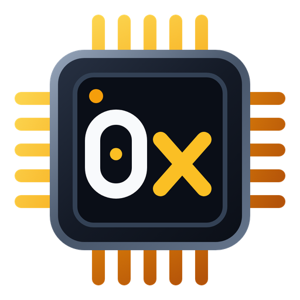

<p align="center">
  
</p>

<h1 align="center">ZeroHex</h1>

<p align="center">
  <strong>Ultra-Lightweight Windows x64 Hex Editor for BIOS, Firmware &amp; Binary Repair</strong><br/>
  Developed by <strong>Nabin Shah</strong> &bull; <a href="https://lyapcare.com.np/">LyapCare</a>
</p>

<p align="center">
  <a href="https://github.com/Nabing954/ZeroHex/releases/latest">
    
  </a>
  <a href="https://github.com/Nabing954/ZeroHex/releases">
    
  </a>
  
  
</p>

---

## Download

Get the latest pre-built Windows x64 binaries from the **[Releases](https://github.com/Nabing954/ZeroHex/releases/latest)** page:

| Package | Description |
|---|---|
| **`ZeroHex-Setup-1.0.0-x64.exe`** | Recommended Windows 10/11 installer — adds Start Menu shortcut, **Open with ZeroHex** / **Compare with ZeroHex** to the Windows 11 modern right-click menu, classic menu, and **Open with** flyout |
| **`ZeroHex-1.0.0-x64-portable.zip`** | Portable archive — extract and run `ZeroHex.exe` anywhere with no installation (settings stored locally in `ZeroHex.toml`) |
| **`SHA256SUMS.txt`** | SHA-256 checksums for verifying download integrity |

---

## Key Features

- **Ultra-Low RAM Usage:** Demand-paged file engine with a small evictable cache (~15 MB idle, <20 MB even with six 16 MB BIOS dumps open simultaneously) and 0% idle CPU.
- **Classic Fast Hex Editor:** Familiar HxD-style workflow with multi-tab editing, overwrite/insert modes, piece-table undo/redo, bookmarks, block selection, and fill/copy/paste in Hex, ASCII, or Offset formats.
- **Side-by-Side Binary Compare:** Instant diff inspection with synchronized scrolling, clickable diff overview scrollbar, difference jumping (`F6` / `Shift+F6`), and byte-level copy across files.
- **Cross-File Right-Click Search:** Select any byte pattern (DMI, Windows key, serial, header) and right-click **Search in ▸** to jump straight to matches inside any other open tab.
- **Firmware & BIOS Repair Tools:** Built-in signature scanner (Intel Flash Descriptor, UEFI FV, AMI, FMAP, DMI/SMBIOS), checksum calculator (CRC32, MD5, SHA-1, SHA-256, 8/16/32-bit sums), data inspector, and text/IPS/`.dif` patch engine.
- **Native Windows 11 Integration:**
  - Right-click **1 file** → **Open with ZeroHex**
  - Right-click **2 files** → **Compare with ZeroHex** (opens directly side-by-side)
  - Right-click **3+ files** → **Open with ZeroHex** (opens all files as tabs)

---

## Verify Downloads (SHA-256)

In PowerShell, verify your downloaded file against `SHA256SUMS.txt`:

```powershell
Get-FileHash .\ZeroHex-Setup-1.0.0-x64.exe -Algorithm SHA256
```

---

## About & Support

- **Developer:** Nabin Shah
- **Organization:** [LyapCare](https://lyapcare.com.np/) — Laptop chip-level motherboard repair, genuine IC & spare parts, and firmware repair solutions (Surunga, Jhapa, Nepal)
- **Bug Reports & Feature Requests:** Open an issue in the [Issues](https://github.com/Nabing954/ZeroHex/issues) tab.

> *This repository distributes official pre-built binaries and documentation for ZeroHex. Source code is proprietary.*
